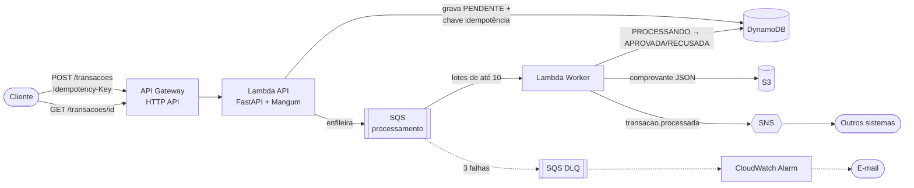
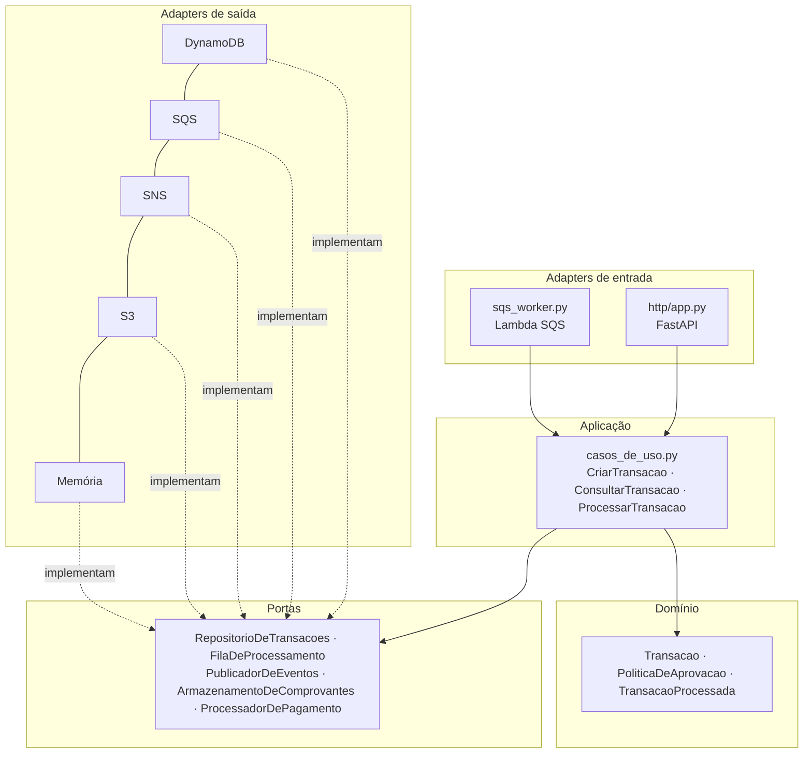
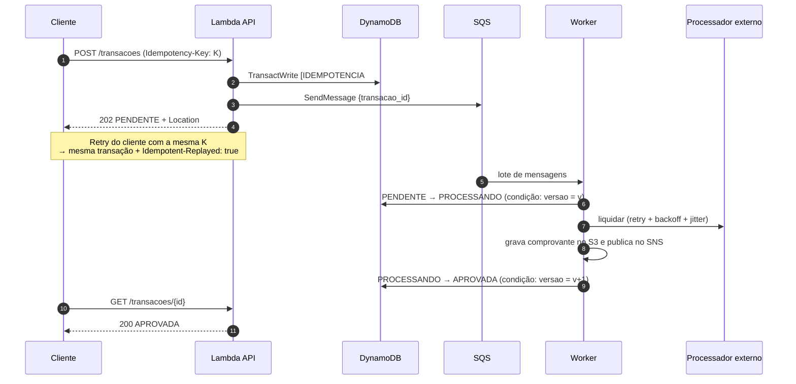
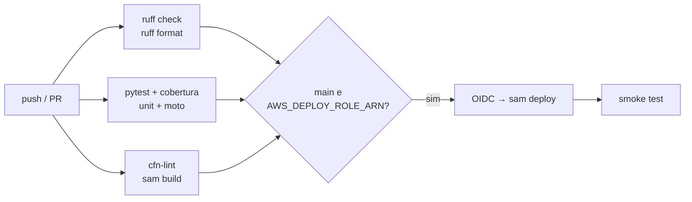

# API de Processamento de Transações Assíncronas

[](https://github.com/Yassm1m/transacoes-async-api/actions/workflows/ci-cd.yml)


O cliente envia um pagamento ou uma transferência, a API responde **na hora** com `202 PENDENTE`
e uma fila processa em segundo plano. O resultado é consultado depois em `GET /transacoes/{id}`.

O foco do projeto não é a regra de negócio (que é simples de propósito), e sim **como** o sistema
se comporta quando as coisas dão errado: requisições duplicadas, mensagens entregues duas vezes,
serviço externo fora do ar, dois workers pegando a mesma transação.

## Destaques

| | |
|---|---|
| **Arquitetura hexagonal** | Domínio e casos de uso não importam `boto3` nem `FastAPI`. A mesma lógica roda em Lambda, em container (ECS) ou em memória nos testes. |
| **Idempotência de ponta a ponta** | `Idempotency-Key` gravada junto com a transação numa única `TransactWriteItems` do DynamoDB: 8 requisições simultâneas com a mesma chave criam **uma** transação (há teste provando). |
| **Resiliência em camadas** | Retry com backoff exponencial + jitter no código → retry do SQS → **DLQ** após 3 tentativas → alarme no CloudWatch. |
| **Consumidor idempotente** | SQS entrega "pelo menos uma vez". Mensagem duplicada é ignorada; lock otimista por versão impede processamento concorrente. |
| **Observabilidade** | Logs JSON com `correlation_id` propagado HTTP → SQS → worker, métricas via CloudWatch EMF, X-Ray e 4 alarmes. |
| **CI/CD** | GitHub Actions: ruff, pytest (98% de cobertura), cfn-lint, `sam build` e deploy via **OIDC** (sem chaves AWS em secrets) com smoke test. |

## Arquitetura



### Camadas (hexagonal)



As dependências apontam sempre **para dentro**: adapters conhecem as portas, as portas conhecem o
domínio, e o domínio não conhece ninguém. `config.py` é o único lugar que liga cada porta ao seu
adapter concreto.

### Fluxo de uma transação



## Estrutura

```
src/transacoes/
├── domain/              # Regras de negócio puras (sem dependências externas)
│   ├── transacao.py     #   entidade + máquina de estados
│   ├── politica.py      #   regra de aprovação (limites)
│   └── eventos.py       #   evento TransacaoProcessada
├── application/         # Casos de uso: orquestram domínio + portas
│   └── casos_de_uso.py
├── ports/               # Interfaces (ABCs) que a aplicação exige do mundo externo
│   └── saida.py
├── adapters/
│   ├── inbound/         # Quem chama a aplicação: HTTP (FastAPI) e worker SQS
│   └── outbound/        # Quem a aplicação chama: DynamoDB, SQS, SNS, S3, memória
├── shared/              # Retry/backoff e observabilidade
└── config.py            # Composition root (injeção de dependências)
tests/
├── unit/                # Domínio, casos de uso, API e worker com adapters em memória
└── integration/         # Adapters reais contra AWS simulada (moto) + fluxo ponta a ponta
template.yaml            # Infra como código (AWS SAM)
infra/github-oidc-role.yaml  # Role para o GitHub Actions fazer deploy via OIDC
docs/adr/                # Registros de decisões de arquitetura
```

## Como rodar

Pré-requisito: Python 3.12+.

```bash
make install       # dependências de desenvolvimento
make test          # 91 testes, cobertura mínima de 90% (atual: 98%)
make lint          # ruff
```

### 1. Local em memória (sem AWS, sem Docker)

```bash
make run
# abra http://localhost:8000/docs (Swagger)
```

Nesse modo a "fila" processa na mesma hora, então o `GET` logo depois do `POST` já mostra `APROVADA`.

### 2. Local com LocalStack (fila de verdade, worker separado)

> Desde março de 2026 a imagem do LocalStack exige um token gratuito. Crie uma conta em
> [app.localstack.cloud](https://app.localstack.cloud), gere o token e coloque no `.env`
> (veja `.env.example`). Os testes do CI **não** dependem disso: usam [moto](https://github.com/getmoto/moto).

```bash
cp .env.example .env   # preencha LOCALSTACK_AUTH_TOKEN
make up                # LocalStack + API (porta 8000) + worker
make logs
```

Para ver retry e DLQ funcionando, suba com falhas injetadas:

```bash
FALHA_SIMULADA_PERCENTUAL=70 make up
```

### 3. Na AWS

```bash
make deploy                       # sam build && sam deploy --guided
make smoke API_URL=https://xxxx.execute-api.us-east-1.amazonaws.com
```

Tudo é serverless e pago por uso; com tráfego de portfólio o custo fica dentro do free tier.
Para remover: `sam delete` (a tabela e o bucket têm `DeletionPolicy: Retain` e precisam ser
apagados à mão, de propósito, para não perder dados por acidente).

## Usando a API

```bash
# Criar
curl -i -X POST "$API/transacoes" \
  -H "Content-Type: application/json" \
  -H "Idempotency-Key: pedido-2026-0001" \
  -d '{"tipo":"TRANSFERENCIA","valor":"150.75","conta_origem":"0001-11111-1","conta_destino":"0001-22222-2"}'
```

```http
HTTP/1.1 202 Accepted
Location: /transacoes/3f1c...
X-Correlation-ID: 9b2e...

{"id":"3f1c...","status":"PENDENTE","valor":"150.75", ...}
```

```bash
# Consultar
curl "$API/transacoes/3f1c..."
# {"id":"3f1c...","status":"APROVADA", ...}
```

| Situação | Resposta |
|---|---|
| Transação aceita | `202` + `Location` |
| Mesma `Idempotency-Key` e mesmo corpo | `202` com a **mesma** transação + `Idempotent-Replayed: true` |
| Mesma `Idempotency-Key` e corpo diferente | `422 IDEMPOTENCY_KEY_REUSED` |
| Sem `Idempotency-Key` ou chave mal formada | `400` |
| Corpo inválido / regra de negócio violada | `422 REQUISICAO_INVALIDA` / `422 TRANSACAO_INVALIDA` |
| Transação inexistente | `404` |

Todas as respostas de erro seguem o mesmo formato e trazem o `correlation_id` para rastrear nos logs:

```json
{"erro": {"codigo": "IDEMPOTENCY_KEY_REUSED", "mensagem": "..."}, "correlation_id": "9b2e..."}
```

**Status possíveis:** `PENDENTE → PROCESSANDO → APROVADA | RECUSADA`.
Valores acima de R$ 10.000,00 são recusados (limite configurável por variável de ambiente).

## Decisões de arquitetura

Resumo; o raciocínio completo está em [`docs/adr/`](docs/adr).

1. **[Arquitetura hexagonal](docs/adr/0001-arquitetura-hexagonal.md)** — isola regra de negócio da
   AWS. Resultado prático: 79 dos 91 testes rodam sem nenhum serviço simulado, em menos de 1 segundo.
2. **[Idempotência com transação atômica no DynamoDB](docs/adr/0002-idempotencia.md)** — "ler
   antes de gravar" tem condição de corrida; `TransactWriteItems` com `attribute_not_exists` não.
   A chave guarda um hash do corpo para diferenciar retry legítimo de reuso indevido.
3. **[Resiliência em camadas](docs/adr/0003-resiliencia.md)** — retry curto em memória para
   soluços de rede; retry longo via visibilidade do SQS; DLQ para o que não se resolve sozinho;
   *partial batch response* para uma mensagem ruim não derrubar o lote inteiro.
4. **[Lambda + SQS em vez de ECS](docs/adr/0004-lambda-sqs.md)** — carga irregular, custo zero
   parado, escala automática. O `Dockerfile` mostra que o mesmo código roda em ECS/Fargate.
5. **[Concorrência com lock otimista](docs/adr/0005-concorrencia.md)** — campo `versao` e escrita
   condicional garantem que só um worker conclui cada transação.

## Observabilidade

- **Logs JSON** (uma linha por evento) com `correlation_id`, `transacao_id`, latência e status.
  O `X-Correlation-ID` recebido na API viaja como atributo da mensagem SQS até o worker.
- **Métricas customizadas** via Embedded Metric Format (namespace `TransacoesAsync`):
  `TransacoesFinalizadas`, `FalhasTransitorias`, `MensagensMalformadas`.
- **Alarmes** (SNS → e-mail): mensagens na DLQ, fila atrasada (> 5 min), erros no worker, 5xx na API.
- **X-Ray** ativo nas duas funções.

Exemplo de consulta no CloudWatch Logs Insights para seguir uma requisição de ponta a ponta:

```
fields @timestamp, servico, mensagem, status, transacao_id
| filter correlation_id = "9b2e..."
| sort @timestamp asc
```

## CI/CD



Para ativar o deploy automático:

1. Crie a role na sua conta: `make oidc GITHUB_ORG=seu-usuario`.
2. No GitHub: *Settings → Secrets and variables → Actions → Variables* → crie
   `AWS_DEPLOY_ROLE_ARN` com o ARN exibido no output (e `AWS_REGION`, se não for `us-east-1`).
3. Crie o environment `dev` em *Settings → Environments* (dá para exigir aprovação manual).

Sem a variável, o pipeline roda lint, testes e validação de infra normalmente e só pula o deploy.

## Próximos passos

- **Outbox via DynamoDB Streams** no lugar do envio direto ao SQS, eliminando a janela entre gravar
  e enfileirar (hoje coberta pela autocura no replay idempotente).
- Lambda consumindo a DLQ para marcar `FALHA` e notificar o cliente.
- Autenticação (Cognito/JWT authorizer no API Gateway) e rate limit por cliente.
- Webhook para o cliente em vez de polling no `GET`.
- Testes de carga com Locust e dashboard no CloudWatch.

## Licença

MIT
